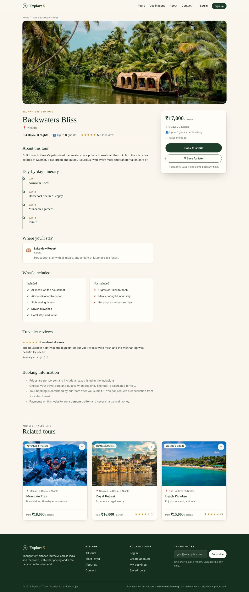
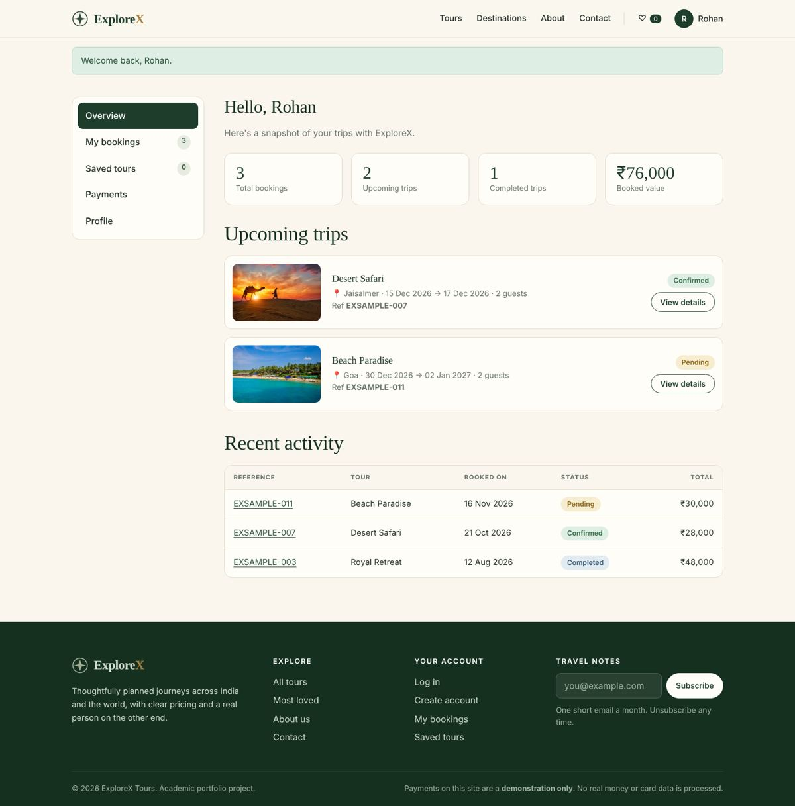
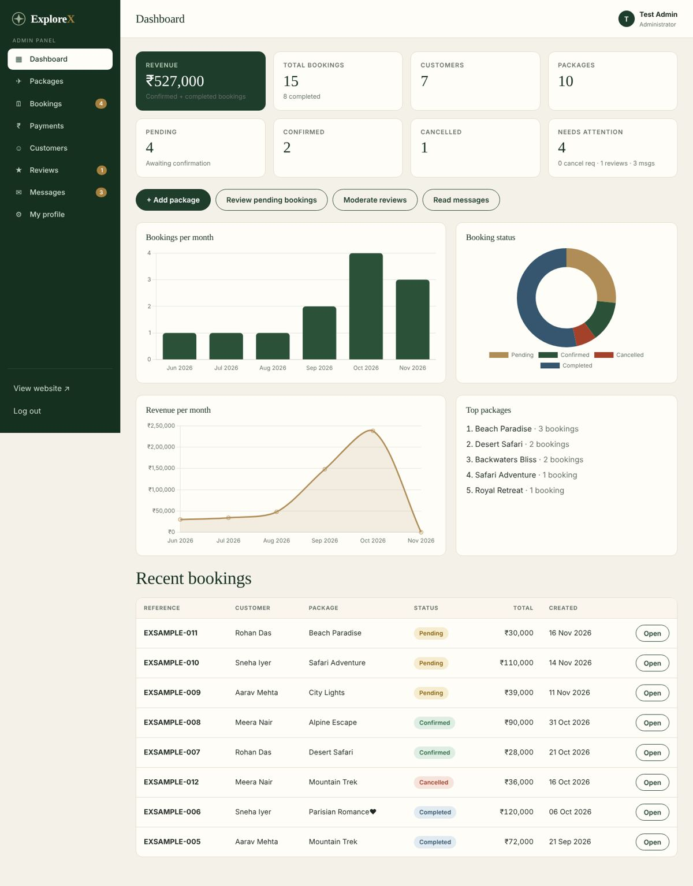

# ExploreX Tours 2.0

A travel booking and management platform built with **plain PHP, MySQL, HTML, CSS and JavaScript** (no frameworks), designed to run locally on **WAMP**. Customers discover and book tours; administrators manage packages, bookings, customers, reviews and messages and watch live analytics.

> **ExploreX Tours 2.0 is an upgrade of the original academic project**, not a rewrite. The original files, data and stack were kept; bugs were fixed, the database was restructured, and the interface and features were rebuilt on top. See [`docs/AUDIT.md`](docs/AUDIT.md) for what was wrong in v1 and what changed.

| Home | Tour details |
|---|---|
|  |  |

## Features

**Customers**
- Discover tours: destination search, style/category, price and duration filters, sorting, pagination (all backed by real MySQL queries)
- Tour pages with gallery, day-wise itinerary, hotels, inclusions/exclusions, reviews and related tours
- Register, log in, log out, profile and password management
- Wishlist (duplicate-proof), booking workflow with server-side price calculation, booking references, status tracking, cancellation requests
- Simulated checkout (success **and** failure paths), payment history
- Star ratings and written reviews, only for completed trips, one per booking

**Administrators**
- Dashboard: live totals, revenue, status breakdown, monthly bookings and revenue charts (Chart.js), recent bookings, top packages
- Packages: add / edit / hide / delete, secure image upload and gallery, itinerary, hotels, inclusions/exclusions, search and filters
- Bookings: search, filter (status, travel dates, cancellation requests), details, confirm / cancel / complete with enforced status rules, simulated payment records
- Customers: search, details, delete with safeguards
- Review moderation, contact message inbox, administrator accounts (super admin only), admin profile and password

| Customer dashboard | Admin dashboard |
|---|---|
|  |  |

More screenshots (packages, booking form, checkout, admin pages, tablet and mobile) are in [`docs/screenshots/`](docs/screenshots/).

## Technology

PHP 8.1+ (MySQLi, prepared statements) · MySQL 8/9 or MariaDB 10.5+ (InnoDB) · HTML5 · CSS3 (custom design system, no CSS framework) · vanilla JavaScript · Chart.js 4 (admin charts, loaded from a CDN) · Google Fonts (Fraunces, Inter; optional, falls back to system fonts).

Required PHP extensions (all enabled by default in WAMP): `mysqli`, `mbstring`, `fileinfo`, `gd` (with WebP). The test suite also needs `curl`.

## Installation on WAMP (Windows)

1. **Copy the project** into `C:\wamp64\www\ExploreXTours-PHP` (any folder name works; the base URL is detected automatically).
2. **Start WAMP** and make sure the icon is green (Apache + MySQL running).
3. **Import the database** in phpMyAdmin (`http://localhost/phpmyadmin`):
   - Click **Import** on the top menu (no need to create a database first)
   - Choose `database/explorex_v2_fresh_install.sql` and click **Import**.
   - This creates `tours_travels`, loads the original v1 data and applies all upgrade migrations.
   - Optional demo data (4 sample customers, bookings, payments, reviews with dates relative to today): select the `tours_travels` database, then import `database/sample_data.sql`. Sample customers all use the password `Demo@1234`.
4. **Configure the application**: copy `config/config.sample.php` to `config/config.php` and edit it if your MySQL settings differ (WAMP default is user `root`, empty password, which works as-is). `config/config.php` is git-ignored.
5. **Create or reset an administrator** (there is no public admin registration). Open a terminal in the project folder and use WAMP's PHP:
   ```bat
   C:\wamp64\bin\php\php8.3.14\php.exe scripts\create_admin.php "Your Name" you@example.com
   ```
   The password is requested at the prompt. To reset the password of an existing admin (the original admin account from v1 was kept, check the `admins` table in phpMyAdmin for its email):
   ```bat
   C:\wamp64\bin\php\php8.3.14\php.exe scripts\create_admin.php --reset admin@example.com
   ```
   Adjust the PHP version folder to match your WAMP install. Super admins can add more administrators in **Admin → Administrators**.
6. **Open** `http://localhost/ExploreXTours-PHP/` (site) and `http://localhost/ExploreXTours-PHP/admin/login.php` (admin).

### Upgrading an existing v1 database instead
Back up first (phpMyAdmin → Export). Then select `tours_travels` and import, **in this order**: `001_innodb_core_schema.sql`, `002_migrate_legacy_data.sql`, `003_enrich_demo_catalog.sql`, `004_drop_legacy_columns.sql`.
Nothing is lost silently: complete copies of the old `bookings` and `packages` tables are stored in `legacy_backup_bookings` / `legacy_backup_packages`. Migration 002 links old bookings to users by email and **removes legacy bookings that match no user** (they stay in the backup table).

### Troubleshooting
| Symptom | Fix |
|---|---|
| "Could not connect to the database" | Check `config/config.php` values and that WAMP's MySQL is running |
| Images not uploading | WAMP's default `upload_max_filesize` is 2 MB; raise it in `php.ini` for up to the 3 MB app limit |
| Broken links or CSS | Set `'base_path' => '/ExploreXTours-PHP'` in `config/config.php` |
| Fonts/charts missing | They load from Google Fonts / jsDelivr, so an internet connection is needed (the site still works without fonts) |

## Simulated payments (important)

Checkout is a **demonstration only**, built to show a payment workflow in a portfolio:
- No real gateway, no real money, and **no card number, expiry or CVV is ever requested, transmitted or stored**
- The customer picks a demo method (Demo Card / UPI / Net Banking) and chooses whether the simulated gateway **succeeds or fails**
- Each attempt is saved in `payments` with a transaction reference (`TXN-DEMO-…`), amount, status and an `is_simulated = 1` flag
- Both customer and admin screens label these records as simulated
- Booking flow: booking is created **Pending** → demo payment → admin **confirms** → after the trip ends admin marks it **Completed**, which unlocks reviews. Revenue on the admin dashboard counts Confirmed + Completed bookings.

## Security overview

Prepared statements everywhere · `password_hash` / `password_verify` with rehash · CSRF tokens on every state-changing request (all state changes are POST) · output escaping · session hardening (HttpOnly, SameSite, strict mode, ID regeneration on login, idle and absolute timeouts) · separate customer and admin sessions with role checks · login throttling · generic login errors · booking ownership enforced in SQL · secure uploads (size limit, real MIME sniffing, image re-encoding, random filenames, execution disabled in `uploads/`) · security headers incl. a Content-Security-Policy · database errors are logged, never shown (in `production` mode) · credentials in a git-ignored config file.

## Folder structure

```
ExploreXTours-PHP/
├── index.php, packages.php, package_details.php   public site
├── book.php, checkout.php, booking_confirmation.php   booking workflow
├── wishlist_toggle.php, newsletter.php, contact.php, about.php
├── user/        login, register, logout, dashboard, bookings, wishlist, payments, profile, review
├── admin/       login, dashboard, packages, bookings, payments, customers, reviews, messages, administrators
├── includes/    bootstrap, db, helpers, auth, layout, admin_layout, booking_lib, uploads
├── assets/      css/app.css, css/admin.css, js/app.js, js/admin.js, img/
├── images/      original sample photos (kept from v1)
├── uploads/     package images uploaded by admins (git-ignored, code execution disabled)
├── config/      config.sample.php  (copy to config.php)
├── database/    migrations 001-004, fresh-install SQL, sample data, legacy v1 dump
├── scripts/     create_admin.php (CLI)
├── tests/       smoke_test.php (end-to-end + security suite)
└── docs/        AUDIT.md, TESTING.md, screenshots/
```

## Database

InnoDB, utf8mb4, 19 tables with 14 foreign keys. Core tables: `users`, `admins` (roles), `categories`, `packages`, `package_images`, `itinerary_days`, `hotels`, `package_inclusions`, `bookings`, `booking_travellers`, `payments`, `wishlist`, `reviews`, `contacts`, `newsletter_subscribers`, `login_attempts`, `schema_migrations`. Booking → user is `ON DELETE SET NULL` (history is kept), booking → package is `ON DELETE RESTRICT` (packages with bookings can only be hidden), everything else cascades. `UNIQUE` keys prevent duplicate wishlist rows, reviews per booking, booking references and double-submitted bookings.

## Testing

```bash
# site running, database imported (+ sample_data.sql), one admin account available
ADMIN_EMAIL=you@example.com ADMIN_PASSWORD='your-password' php tests/smoke_test.php http://localhost/ExploreXTours-PHP
```
On Windows PowerShell: `$env:ADMIN_EMAIL='...'; $env:ADMIN_PASSWORD='...'; php tests\smoke_test.php http://localhost/ExploreXTours-PHP`.
173 checks cover the customer journey, admin panel, SQL injection, XSS, CSRF, session handling, authorisation, booking ownership, upload attacks and input validation. Results and manual checks are in [`docs/TESTING.md`](docs/TESTING.md). The suite creates throw-away accounts and removes them afterwards.

## Known limitations

- Photos are the 11 originals from v1 (no new image licences were added); package galleries support more images through the admin upload.
- No email sending: contact messages are stored for the admin, newsletter addresses are only collected; there is no password-reset-by-email or email verification.
- Developed and tested with PHP 8.3 and **MariaDB 10.11**. The SQL avoids MariaDB-only syntax and targets MySQL 8/9 (WAMP), but it has not been executed on MySQL 9.1 itself.

## License / credits

Academic MCA portfolio project by Diya Kansara. Original ExploreX Tours v1 code and sample photographs © the author.
